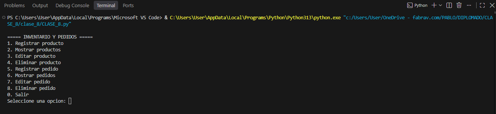
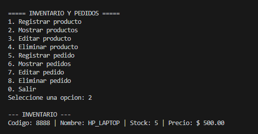
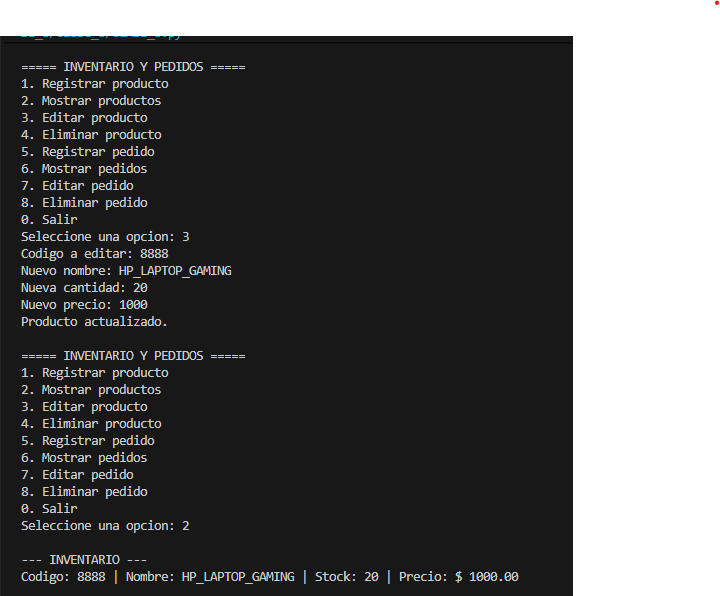

# CLASE 8: Sistema de gestión de pedidos e inventario

Actividad de **Arreglos y tipos abstractos de datos (Parte 1)** realizada en Python.

## ¿Qué hace el programa?

Permite registrar, mostrar, editar y eliminar productos y pedidos desde un menú. Usa listas para almacenar los datos y funciones para organizar cada operación. Al registrar un pedido descuenta las unidades del inventario; al eliminarlo, las devuelve si el producto todavía existe.

4. Seleccionar las opciones del menú. Primero registrar un producto y luego crear un pedido.

## Funciones principales

- `registrar_producto`, `mostrar_productos`, `editar_producto`, `eliminar_producto`: gestionan el inventario.
- `registrar_pedido`, `mostrar_pedidos`, `editar_pedido`, `eliminar_pedido`: gestionan los pedidos.
- `buscar_producto`, `buscar_pedido`: encuentran registros por su código o número.
- `menu`: muestra las opciones y permite repetir acciones hasta elegir 0.

## Estructuras utilizadas

- **Listas:** almacenan productos y pedidos; cada registro es otra lista.
- **Condicionales `if`:** validan las opciones, los datos y el stock.
- **Ciclos `for`:** recorren los registros.
- **Ciclo `while`:** mantiene el menú activo.
- **Funciones:** separan las distintas tareas para facilitar cambios futuros.

## Capturas del programa en ejecución

### Menú principal

### Productos registrados

### Pedidos registrados

